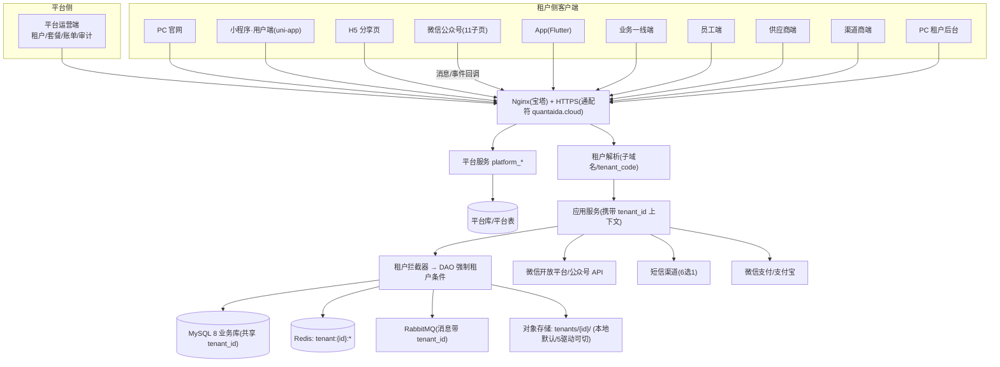

# 母婴亲子 数字化多端平台 PRD（多租户 SaaS）

> 品牌背景：面向**全国母婴亲子服务机构（月子中心 / 母婴店 / 育儿服务 / 亲子早教 / 产后康复机构，单体或连锁门店）**的多租户 SaaS 运营平台。业务范围：母婴护理与育儿服务（月嫂/育儿嫂/上门护理）、产后康复、亲子早教/活动、母婴商品零售（含母婴食品/辅食）、会员储值卡券。以"家庭会员档案"为主数据贯穿全业务，覆盖会员注册、服务预约（到店/上门）、商品下单、支付、履约核销、会员储值、售后、复购全流程线上化、数据可追溯、服务标准化。
> 项目名称：母婴亲子数字化多端平台（多租户 SaaS）
> 产品矩阵：PC 品牌官网（中英双语 SEO） + **平台运营端（SaaS 控制台，强制）** + PC 租户后台 + 微信服务号（全量公众号运营 11 子页） + 微信小程序·用户端（uni-app） + H5 分享页 + 业务一线端（母婴护理师/育儿师） + 员工端（店长/店员） + 供应商端 + 渠道商端 + **独立 App（Flutter，iOS+Android）** + 开放 API
> 上线模式：一次性完整上线，不分一期二期
> 存储方案：抽象对象存储驱动层，支持 5 驱动可视化切换（**本地磁盘为默认主驱动** / AWS S3 / 阿里云 OSS / 腾讯云 COS / MinIO）。后台选驱动、填参数、连接测试通过后保存生效，无需改代码。商品图、服务详情、资质文件、App 素材、草稿正文图片全部写入选中存储，路径按租户前缀 `tenants/{tenantId}/` 隔离。
> 架构说明：前后端分离，对标【中医馆数字化平台（公众号+小程序+PC官网+后台管理）】并叠加**多租户 SaaS 底盘**。保留：RBAC 多角色、全操作审计、UnionID 会员互通、多驱动对象存储、多语言 i18n、菜单可视化、系统参数可视化、富文本 CMS、消息配置（4 通道 + 6 短信渠道）、SSO 单点登录、公众号运营管理 11 子页。强制双后台：平台运营端（管租户）+ 租户后台（管业务），全表 `tenant_id` 隔离。

## 核心约束（母婴亲子行业合规与多租户红线，代码强制约束）
1. **多租户 SaaS 强制（第一红线）**：平台运营端与租户后台物理分离，两条请求链路、两套菜单/角色/登录入口；所有业务表带 `tenant_id` 且建复合索引，DAO/拦截器强制注入，缓存 `tenant:{id}:`、存储 `tenants/{id}/`、定时任务按租户分片。禁止单商户自用版本。
2. 行业合规：母婴护理机构应具备母婴保健服务资质；涉及母婴食品/辅食的须**食品经营许可证**；婴幼儿用品须 3C/质检；护理人员资质证照（护士/育婴师/月嫂证）到期预警；广告文案禁止宣传医疗保健功效、禁止绝对化用语，商品页标注成分/适用年龄/执行标准。
3. 会员/儿童隐私：手机号、身份证号加密存储、展示脱敏；婴幼儿健康/过敏信息按角色权限脱敏；后台所有操作写审计。
4. 多语言：默认简体中文 + English 双语；后台可启用/停用更多语言，各端内容按语言独立录入。
5. 菜单全部可视化：公众号自定义菜单、PC 官网导航、PC 后台导航、小程序 tabBar、H5 底部导航、App 底部导航，全部后台拖拽编辑，无需发版。
6. 金额/比例/佣金/配送费/积分规则一律"后台可配置"，不写死。

## 一、架构设计（Q13 标准档）

### 1.1 需求摘要

#### 功能需求（按端）
| 端 | 核心功能 | 依赖模块 |
|---|---|---|
| 平台运营端 | 租户管理/套餐配额/账单计费/平台公告/平台审计/平台账号 | 多租户底盘 |
| PC 官网 | 品牌展示、服务与商品、门店、资讯、在线咨询、SEO | CMS、i18n |
| 租户后台 | 系统参数/菜单/消息/SSO/公众号/会员/服务预约/商品/订单/储值/营销/员工/供应商/渠道商/报表 | RBAC、审计 |
| 小程序·用户端 | 登录、预约、下单、支付、订单、会员储值、卡券、亲子活动 | UnionID、支付 |
| H5 分享页 | 分享落地、活动、支付回跳、表单 | UnionID |
| 公众号 | 11 子页运营（账号/统计/标签/粉丝/消息/模版查看/菜单发布/自动回复/素材/草稿/发表记录） | 公众号管理 |
| 业务一线端 | 母婴护理师/育儿师：接单、签到、服务打卡、记录、拍照 | 派单、UnionID |
| 员工端 | 店长/店员：订单核销、库存、会员开卡、排班 | 订单、库存 |
| 供应商端 | 供货单、送货、对账、结算、资质上传 | 供应商管理 |
| 渠道商端 | 报单、佣金、额度、订单、下级 | 渠道商管理 |
| 独立 App | 会员端（预约/下单/会员/服务）Flutter 双端 | UnionID |
| 开放 API | 第三方对接（商品/订单/会员） | 鉴权、配额 |

#### 非功能需求（NFR）
| 维度 | 指标 |
|---|---|
| 并发 | 峰值 QPS 以下单/查询分开计算（具体数值待业务确认） |
| 响应 | 页面首屏 < 2s；接口 P95 < 500ms |
| 可用性 | 99.5%（宝塔单机部署需说明单点风险 + 备份告警） |
| 数据量 | 3 年会员量/订单量/素材容量（待业务确认） |
| 安全 | 全站 HTTPS；密钥 AES 加密；审计留存 ≥ 180 天；敏感字段加密脱敏 |
| 合规 | 母婴保健资质/食品经营许可/ICP 备案/隐私政策/个人信息保护 |
| 可维护 | 金额、比例、佣金、开关后台可配，覆盖率 100%（不得写死） |

### 1.2 架构图（多端一后端 + 多租户两条链路）



### 1.3 ADR 架构决策记录（标准档 3 条 + 多租户两条必写）

#### ADR-001：多租户数据隔离 — 共享库 + tenant_id
- **状态**：已接受
- **背景**：母婴亲子 SaaS 面向大量中小机构，需低成本起步、跨租户统计容易；预期租户数起步 < 50。
- **决策**：共享库 + `tenant_id` 行级隔离（MyBatis-Plus TenantLineInnerInterceptor 强制注入）。
- **备选与取舍**：A 独立 schema — 隔离强但连接池/DDL 管理复杂，中小规模不划算；B 独立库 — 最强隔离但成本高，仅大客户专属。
- **后果**：成本低、运维简单；依赖代码纪律，靠拦截器 + 越权用例 + 代码扫描兜底。升级阈值：租户 > 50 或单租户 > 500 万行或单库 > 200GB → 评估独立 schema。

#### ADR-002：平台端与租户端分离
- **状态**：已接受
- **背景**：平台运营（管租户/套餐/账单）与租户业务（管会员/订单）职责完全不同。
- **决策**：两套路由（`/platform/*` 与 `/tenant/*`）、两套菜单、两套角色、两个登录入口；共用用户表时带 `user_type`（PLATFORM/TENANT）。
- **备选与取舍**：A 单后台切租户 — 省事但权限易混、审计不清、越权风险高，否决。
- **后果**：边界清晰、审计可分；实现成本略高，但长期可维护。

#### ADR-003：多端组织 — 一后端 + 多前端壳（uni-app + Flutter）
- **状态**：已接受
- **背景**：本期业务多端全量（用户端/一线端/员工端/供应商端/渠道商端 + App + 开放API）。
- **决策**：一套后端 API/权限/UnionID/存储；小程序用 uni-app 多环境/多子包构建，App 用 Flutter 单仓双端；各端仅界面与角色权限不同。
- **备选与取舍**：A 每端独立后端 — 重复造轮、数据割裂，否决；B 每端各写原生 — 维护成本高。
- **后果**：复用高、迭代快；需做好端间权限与数据边界。

#### ADR-004：对象存储抽象为 StorageProvider
- **状态**：已接受
- **背景**：客户对存储来源要求不一（私有化本地优先，云端按需）。
- **决策**：统一 StorageProvider 接口，5 驱动（本地/S3/OSS/COS/MinIO）可切，路径 `tenants/{id}/`。
- **后果**：切换不动业务代码；需保证历史文件仍由原驱动读取。

### 1.4 技术选型对比表
| 维度 | 方案 A | 方案 B | 方案 C | 结论与理由 |
|---|---|---|---|---|
| 后端语言/框架 | Java 17 + Spring Boot 3 + MyBatis-Plus | PHP + Laravel | Python + FastAPI | 选 A：多租户拦截器生态成熟、并发与长期演进好 |
| 数据库 | MySQL 8（utf8mb4） | PostgreSQL | SQL Server | 选 A：事务与生态成熟、成本低；复杂 JSON/地理再评估 B |
| 前端框架 | Vue3 + Element Plus | React + AntD | — | 选 A：vue-pure-admin 模板成熟、开发快 |
| 小程序方案 | uni-app（多环境） | 微信原生 | Taro | 选 A：多端全量场景复用最高 |
| 部署方式 | 宝塔面板 | Docker Compose | K8s | 选 A：客户现有宝塔运维习惯；证书统一 quantaida.cloud 通配符；**Nginx 不加 IPv6 监听** |

### 1.5 风险与缓解（≥3）
| 风险 | 影响 | 概率 | 缓解 |
|---|---|---|---|
| 漏加 tenant_id 跨租户越权 | 数据串号/合规事故 | 中 | 拦截器强制注入 + 代码扫描 + 越权用例进回归 |
| 配额/生命周期只在前端控制 | 白嫖/欠费仍用 | 中 | 服务端强校验 + 状态机 + 审计 |
| 微信接口权限/认证不足 | 公众号/支付不可用 | 高 | 上线前完成认证、IP 白名单、模板申请；预留降级 |
| 同一 appId 被现网系统接管 | 回调互踢/菜单互盖 | 中 | 接号前查服务器 URL/粉丝/菜单；走四步切换 |
| 多端登录/数据不一致 | 会员重复、订单错乱 | 中 | 统一 UnionID + 单后端 + 幂等键 |
| 支付回调重复/丢失 | 重复发货/漏单 | 中 | 幂等 + 主动查单 + 对账任务 |
| 宝塔单机单点故障 | 宕机不可用 | 中 | 定时备份 + 监控告警 + 恢复演练 |
| 母婴食品/用品合规 | 下架/处罚 | 中 | 资质审核 + 商品成分/适用年龄标注 + 广告审核 |

### 1.6 扩展规划
- 端增长：新增端只加前端壳 + 角色，不改后端。
- 租户增长：阈值 50 租户 / 单租户 500 万行 / 单库 200GB → 评估独立 schema；跨租户汇总走只读库/离线任务。
- 并发增长：先加 Redis 缓存与读写分离 → 队列削峰 → 最后分库分表。
- 当前不做：微服务拆分、K8s、分库分表（未选）。

## 二、多租户设计（强制）

### 2.1 租户域模型（核心表）
| 表 | 关键字段 |
|---|---|
| `platform_tenant` | tenant_id(PK) / tenant_code(唯一) / name / industry / contact / phone / plan_id / status / trial_end_at / expire_at / seat_limit / mp_account_limit / storage_quota_gb / sms_quota / api_quota / created_at |
| `platform_plan` | plan_id / 名称 / 价格 / 计费周期 / 含端数量 / 席位 / 公众号数 / 存储 / 短信 / API 额度 / 是否可试用 |
| `platform_tenant_quota_usage` | tenant_id / 已用席位 / 已用公众号 / 已用存储 / 已用短信 / 已用 API / 统计日期 |
| `platform_bill` | bill_id / tenant_id / 账期 / 计费项 / 数量 / 金额 / 状态（待付/已付/逾期） |
| `platform_audit` | 平台操作日志：操作人 / 动作 / 目标租户 / 结果 |
| `platform_tenant_admin` | tenant_id / user_id / 是否主管理员 |

> 业务表统一追加 `tenant_id NOT NULL`，复合索引 `(tenant_id, created_at)`、`(tenant_id, status)`；唯一约束带租户维度 `UNIQUE(tenant_id, code)`；禁止裸 `WHERE id=?`。

### 2.2 平台运营端页面清单
| 页面 | 关键动作 |
|---|---|
| 租户管理 | 列表（编码/名称/行业/套餐/状态/到期/已用席位/公众号数）；开通、停用、恢复、续期、删除（二次确认+归档提示） |
| 租户开通向导 | 基本信息 → 选套餐 → 配额确认 → 初始化（默认角色/菜单/参数/存储目录）→ 生成主管理员账号 |
| 套餐与配额 | 套餐 CRUD；单租户配额调整留痕；超限策略（拦写/只读） |
| 账单与计费 | 账单列表（账期/金额/状态）、生成账单（**按账号数/席位数**）、标记已付、导出 |
| 平台公告 | 公告 CRUD、按租户/套餐定向、已读统计 |
| 平台审计 | 平台操作/登录/异常登录告警；可按租户筛选 |
| 平台账号与角色 | 平台超管/平台运营/平台财务（与租户角色隔离） |

### 2.3 隔离四条铁律
1. 所有业务表带 `tenant_id` + 复合索引。
2. DAO/拦截器强制注入租户条件，手写 SQL 也必须带。
3. 缓存 key `tenant:{id}:...`，对象存储 `tenants/{id}/...`。
4. 定时任务按租户分片遍历，禁止全表扫。

### 2.4 配额与计费
- 五类配额：席位 / 公众号数 / 存储 GB / 短信条数 / API 调用量。
- 校验位置：网关（API 量）+ 服务层（席位/公众号/存储/短信），超限返回明确错误码与升级引导。
- **计费维度：按账号数/席位数**（Q14.2）。欠费三级递进：提示 → 限写 → 停服，可配。

### 2.5 租户生命周期
```
试用(trial) → 正常(active) → 欠费(overdue) → 停用(suspended) → 到期(expired)
                  ↑ 缴费可回 active        ↑ 平台可恢复
```
- 试用 14 天（默认），到期按配置转只读/到期；到期只读宽限 7 天（默认）。
- suspended：拒登录、接口 403、数据保留可导出；公众号回调只落库不执行业务。

## 三、端矩阵表（业务多端全量）
| 端 | 承载角色 | 平台形态 | 登录方式 | 本期生成 | 说明 |
|---|---|---|---|---|---|
| 平台运营端 | 平台超管/运营/财务 | Web 独立后台 | 平台账号 | ✅ 强制 | 与租户后台彻底隔离 |
| PC 品牌官网 | 访客/会员 | Web（SEO 中英） | 免登/UnionID | ✅ | 与租户子域名/租户编码绑定 |
| PC 租户后台 | 租户管理员/店长/财务/运营/客服 | Web | 租户账号/SSO | ✅ | 全表 tenant_id |
| 小程序·用户端 | 会员/客户 | 微信小程序（uni-app） | UnionID | ✅ | 核心 C 端 |
| H5 分享页 | 访客/会员 | H5（微信内+浏览器） | UnionID | ✅ | 分享落地/支付回跳 |
| 微信公众号 | 会员/粉丝 | 服务号（11 子页） | UnionID | ✅ | 待新申请 |
| 业务一线端 | 母婴护理师/育儿师 | 小程序或 H5 | 独立账号 | ✅ | 接单/打卡/记录 |
| 员工端 | 店长/店员 | 独立小程序或 H5 | 独立账号 | ✅ | 核销/库存/开卡 |
| 供应商端 | 供应商 | 独立小程序 | 独立账号 | ✅ | 供货/对账/结算 |
| 渠道商端 | 渠道商 | 独立小程序 | 独立账号 | ✅ | 报单/佣金/额度 |
| 独立 App | 会员 | Flutter（iOS+Android） | UnionID/账号 | ✅ 已确认 | 单仓双端 |
| 开放 API | 第三方 | REST | AppKey/Secret | ✅ | 配额鉴权 |

> 复用原则：一个后端 + 多前端壳，共用 API/权限/UnionID/对象存储；各端差异仅在界面与角色权限。**租户边界**：平台端只看汇总与租户状态，看不到租户业务明细；租户后台所有端共享同一 `tenant_id` 数据面。

## 四、技术栈配置表（按问卷落档，禁止替换）
| 层级 | 选型 | 版本/要点 |
|---|---|---|
| 后端语言 | Java | JDK 17 |
| 后端框架 | Spring Boot 3 + MyBatis-Plus | SB 3.2.x；MP 3.5.x（TenantLineInnerInterceptor 租户插件） |
| 数据库 | MySQL 8 | 详见 4.1 配置项 |
| 缓存 | Redis | 缓存/会话/限流/分布式锁，详见 4.2 |
| 消息队列 | RabbitMQ | 异步任务/延迟队列，详见 4.3 |
| 后台前端 | Vue3 + Vite + TS + Element Plus | vue-pure-admin 模板 |
| 小程序 | uni-app | 多环境/多子包构建，用户端/一线端/员工端/供应商端/渠道商端共用壳 |
| H5 | uni-app H5 / Vue3 | 分享落地页 |
| 独立 App | Flutter | iOS+Android 单仓双端 |
| 对象存储 | 本地磁盘（默认，5 驱动可切） | 本地/S3/OSS/COS/MinIO，详见 4.4 |
| 部署 | 宝塔面板 | Nginx + HTTPS（通配符证书 quantaida.cloud，不加 IPv6 监听），详见 4.5 |
| 增值能力 | 微信支付+支付宝 / 短信 / 会员积分卡券 / 定时任务 | 已纳入 |
| 多语言 | 中/英 i18n | 已内置 |

### 4.1 MySQL 8 配置项
- 连接地址/端口/库名/用户名/密码：环境变量注入，禁止硬编码；字符集 utf8mb4 / utf8mb4_unicode_ci。
- 连接池 HikariCP maximum-pool-size=20，connection-timeout=30000ms。
- 读写分离主从可选；自动备份每日 02:00 全量，保留 7 份。

### 4.2 Redis 配置项
- 连接池 maxTotal=200；用途：参数缓存、验证码、限流、防重、分布式锁（编号/下单/派单/结算并发）。key 前缀 `tenant:{id}:`。

### 4.3 RabbitMQ 配置项
- 用途：预约/订单/短信/模板消息异步推送、秒杀削峰、报表任务、到期预警延迟队列。队列持久化、手动 ACK、失败重试；消息体带 tenant_id。

### 4.4 对象存储配置（5 驱动可切，本地默认）
- 后台「对象存储配置页」：5 张等大卡片单选 → 动态滑出参数表单（未选中不渲染）→ AK/SK 密码框+眼睛 →「连接测试」通过才亮「保存并应用」→ 切换二次确认。
- 本地驱动：存储路径、外网访问前缀 URL；云端驱动：Endpoint/Region/AK/SK/Bucket/外网域名。密钥 AES 加密。

### 4.5 宝塔面板部署
- Nginx 反代后端 Spring Boot jar + 托管各前端静态资源（后台/官网/uni-app H5 构建产物）；HTTPS 使用**通配符证书 quantaida.cloud**；**Nginx 不配置 IPv6 监听**（仅 IPv4 listen）。
- 后端 jar 由宝塔进程守护/systemd 托管开机自启；MySQL/Redis/RabbitMQ/本地存储按宝塔环境部署。
- 采用宝塔站点 + 伪静态 + 计划任务；日志轮转与每日备份。

## 五、需求校验补充
1. **系统全局参数可视化配置**：站点名、Logo、ICP、客服、工作时间、SEO 默认词、公众号/小程序/支付/存储/多语言开关，后台表单保存实时生效。
2. **多语言 i18n**：语言列表启用停用、前台切换器、各内容多语言字段、富文本多语言 tab；默认中/英。
3. **菜单可视化**（唯一出处见模块 3）：公众号/PC 官网/PC 后台/小程序 tabBar/H5 底部/App 底部，拖拽编辑、实时预览、整树保存即时生效、公众号发布走菜单管理子页。
4. **消息配置（4 通道 + 6 短信渠道 + 模板表）**：公众号模板消息/小程序订阅消息/App 推送/站内信；短信 6 渠道单选互斥；模板 ID 按租户绑定。
5. **SSO 单点登录**：CAS/OAuth2/OIDC/Sa-Token 四协议，账号映射、故障降级账号密码。
6. **公众号运营 11 子页**（详见 6.3）：账号管理（凭证唯一入口）/数据统计/标签/粉丝/消息/模版查看/菜单发布/自动回复/素材/草稿/发表记录。
7. **会员储值/积分/卡券**：储值余额、积分抵扣、优惠券/卡券发放与核销，规则后台可配。
8. **服务预约（到店/上门）**：分时段预约、派单、核销码、改约/取消；上门核算师/育儿师 GPS 签到。
9. **商品商城**：母婴用品/食品辅食，规格、库存、套餐、拼团/秒杀、订单、支付、售后。
10. **供应商/渠道商**：供应链供货对账、渠道分销佣金报单结算。
11. **接口防护**：下单/预约/支付/报单防重 + 限流防刷；敏感词校验。
12. **数据备份**：数据库定时备份 + 存储版本保护，恢复演练。
13. **富文本 CMS + 敏感词 + 用户协议/隐私协议弹窗**。

## 六、功能模块完整清单

### 6.1 平台运营端（详见第二章 2.2）
租户管理、租户开通向导、套餐与配额、账单与计费（按账号数）、平台公告、平台审计、平台账号与角色、平台看板。

### 6.2 租户后台（业务管理，全表 tenant_id）
1. **系统全局配置**：站点/ICP/客服/SEO/公众号/小程序/支付/存储/多语言开关。
2. **多语言 i18n**（模块 2）。
3. **菜单可视化**（模块 3，唯一出处）。
4. **消息配置**（模块 12：4 通道 + 6 短信渠道 + 模板表，模板 ID 按租户绑定）。
5. **SSO 配置**（模块 13：四协议、账号映射、降级）。
6. **公众号运营管理**（模块 11，11 子页，见 6.3）。
7. **会员管理**：家庭会员档案、等级、积分、储值、卡券、标签；手机号/证件加密脱敏。
8. **门店管理**：门店档案、营业时间、服务范围、配送范围、坐标；连锁多门店数据视图。
9. **服务管理**：服务项目/套餐、价格、时长、适用年龄、上下架；护理人员排班。
10. **预约与派单**：分时段预约、派单（护理师/育儿师）、签到、核销、改约/取消。
11. **商品与库存**：SPU/SKU、规格、库存、安全库存预警、上下架。
12. **订单与履约**：订单、支付（微信/支付宝）、核销、售后/退款、履约记录。
13. **会员储值/积分/卡券/营销**：储值充值消费、积分抵扣、优惠券/拼团/秒杀/推荐。
14. **员工与排班**：员工档案、资质证照（到期预警）、排班、绩效工时。
15. **供应商管理**：供应商档案/协议、采购/供货单、入库、对账、结算、评级。
16. **渠道商管理**：渠道商档案、佣金规则、报单审核、额度、结算、下级。
17. **报表**：会员/预约/订单/营收/储值/渠道分佣/服务质量统计，多维+Excel 导出。
18. **权限与审计**：租户角色（租户管理员/店长/前台/护理主管/护理师/育儿师/康复师/财务/库管/人事/供应商/渠道商/会员）；审计日志可检索导出（含 tenant_id）。
19. **账号安全（修改密码）**：各角色个人中心自助改密。

### 6.3 微信公众号运营管理（11 子页，Q11 全量·待新申请）
> 入口：后台「公众号管理」一级菜单；顶部公众号切换器；按 appId 隔离；密钥 AES 加密掩码；errCode/errMsg 原样落库；写操作入审计。**前提：待新申请认证服务号**（未认证/订阅号能力按实际裁剪）。
| 子页 | 路由 | 一句话能力 | 关键字段/动作 |
|---|---|---|---|
| 账号管理 | `/mp/account` | 凭证唯一入口（公众号+小程序） | 名称/微信号/appId/服务器URL/二维码/备注；公众号 AppID/AppSecret/服务器URL/Token/EncodingAESKey/网页授权域名/JS安全域名；小程序 AppID/AppSecret/合法域名；清空API配额 |
| 数据统计 | `/mp/statistics` | 运营看板 4 图 | 用户增减/累计用户/消息概况/接口分析（7/15/30天） |
| 标签管理 | `/mp/tag` | 粉丝分组标签 | 编号/名称/粉丝数/创建时间；新增(推微信)/同步/删除 |
| 粉丝管理 | `/mp/user` | 粉丝台账 | openid/头像/昵称/性别/地区/备注/标签/订阅状态/时间；同步/打标签/复制openid |
| 消息管理 | `/mp/message` | 收发消息流水 | 发送时间/类型/发送方/openid/内容；按类型+创建时间筛选；原样 errCode |
| 模版消息 | `/mp/message-template` | 微信模板库镜像（**只同步/查看，不发送**） | 模板ID/标题/内容/示例/行业；发送与节点映射归消息配置 |
| 菜单管理 | `/mp/menu` | 菜单发布闸门（不在此编辑） | 选择配置/保存并发布/清空；层级校验；发布后需重新进入公众号可见 |
| 自动回复 | `/mp/auto-reply` | 关注/消息/关键词三 tab | 关键词/匹配类型/回复类型/内容；6 类回复体；音乐改音频(voice) |
| 素材管理 | `/mp/material` | 永久素材库 | 图片/语音/视频 tab（视频需 thumb）；格式大小校验；media_id/复制 |
| 图文草稿箱 | `/mp/draft` | 图文草稿 | 标题/作者/原文地址/封面/摘要/富文本；多篇合成多图文 |
| 图文发表记录 | `/mp/free-publish` | 发表结果追溯 | 标题/发表时间/状态/失败原因/msg_id |

> 去重：菜单可视化编辑归模块 3；菜单发布/清空在 `/mp/menu`；模板消息发送归模块 12；微信凭证只在 `/mp/account`。

### 6.4 小程序·用户端（uni-app）
首页（Banner/服务/商品/门店/快捷入口/公告）→ 登录（UnionID）→ 服务预约（到店/上门，分时段，核销码）→ 商品商城（分类/规格/购物车/下单/支付）→ 订单（待付/待用/已完成/售后）→ 会员中心（储值/积分/卡券/宝宝档案/成长记录）→ 亲子活动报名 → 消息中心 → 个人中心（协议/多语言/修改密码）；tabBar 后台可视化。

### 6.5 H5 分享页
与小程序同源（UnionID）：服务/商品详情、预约、活动、下单、支付回跳、表单；适合微信转发与广告落地。

### 6.6 业务一线端（母婴护理师/育儿师，小程序或 H5）
登录 → 待接/已接工单（服务时间/客户/地址/项目）→ 上门 GPS 签到 → 服务过程打卡/拍照/记录（宝宝体征/护理记录）→ 完成确认/客户电子签名 → 我的排班/收入 → 个人中心（修改密码/消息/协议）。

### 6.7 员工端（店长/店员，独立小程序或 H5）
登录 → 今日预约/到店核销 → 会员开卡/储值 → 商品扫码/库存 → 订单处理 → 排班 → 报表简报 → 个人中心（修改密码）。

### 6.8 供应商端（小程序）
登录 → 供货单（待接/配送中/已送达）→ 送货签收 → 对账/结算单 → 资质上传 → 消息 → 个人中心（修改密码）。

### 6.9 渠道商端（小程序）
登录 → 报单（提交/审核状态）→ 佣金明细 → 额度查询 → 我的订单/下级 → 结算记录 → 个人中心（修改密码）。

### 6.10 独立 App（Flutter，会员端，iOS+Android）
单仓双端（共享 core/widget/api）：登录（UnionID/账号）→ 首页（服务/商品/门店/活动）→ 预约 → 商城下单/支付 → 订单 → 会员中心（储值/积分/卡券/宝宝档案）→ 消息（厂商推送 + 微信订阅兜底）→ 个人中心（修改密码/协议/多语言）；底部导航后台可视化。与小程序/公众号/H5 同源数据，禁止孤岛端。

### 6.11 PC 品牌官网（中英双语 SEO）
首页（Banner/品牌/服务/商品/门店/资讯/工程合作/资质）、服务与商品中心、门店分布、品牌故事、资讯动态（富文本双语）、在线咨询/表单、联系我们；PC+移动自适应，预留跳小程序/App。

### 6.12 开放 API
REST，AppKey/Secret 鉴权，覆盖商品/订单/会员只读或按授权范围；配额与限流；接口文档与沙箱。

### 6.13 对象存储层 / 多语言 i18n 层
- 存储：5 驱动可切、路径 `tenants/{id}/`、密钥加密、版本保护。
- i18n：语言包管理、多语言字段、富文本语言 tab、前台切换器，默认中/英。

## 七、技术硬性约束
前后端分离 + 多租户 SaaS；保留 RBAC、审计、UnionID、多驱动存储、i18n、菜单可视化、系统参数可视化、富文本 CMS、消息配置、SSO、公众号 11 子页。母婴亲子业务模型：会员/宝宝档案 → 服务预约/上门派单 → 商品下单 → 支付 → 履约核销 → 储值复购 → 售后；供应链（供应商）与分销（渠道商）闭环。

## 八、后台 UI/UX 设计规范（开发必须照做）
- 后台：Vue3 + Vite + TS + Element Plus，基于 vue-pure-admin，禁止手写 layout/路由/权限/菜单；8px 栅格、圆角 6px、统一主色；左侧折叠菜单 + 顶部面包屑/消息/头像 + 多页签。
- **对象存储配置页**：5 卡片单选 → 动态表单 → AK/SK 密码框+眼睛 → 连接测试通过才亮保存 → 切换二次确认。
- **富文本**：WangEditor 5，工具栏齐全，粘贴即上传对象存储，多语言 tab，Word/网页粘贴清洗，非 textarea。
- **上传组件**：独立卡片块独占整行；拖拽/多图/缩略图/调序/放大/批量删除/进度/重试；资质/合同附件独立列表式上传。
- **列表页**：筛选可折叠 + 操作区 + 斑马纹 + 右下分页；**表单页**左右分栏（左 2/3 主，右 1/3 辅）；弹窗主按钮右下、危险红+二次确认；空状态插图；骨架屏。
- **菜单可视化**：左菜单树 + 中属性面板 + 右实时预览（PC/手机/App 外壳）。
- **多语言**：顶栏语言切换；内容字段「中/EN」tab，未填红点。

## 九、客户上线前置材料清单
### 9.1 平台与资质
1. 平台运营主体营业执照、ICP 备案
2. 公众号（服务号）AppID/AppSecret（**待新申请**）；小程序 AppID/AppSecret；微信开放平台账号（UnionID）
3. 微信支付商户号 + 支付宝（如需）
4. 服务器/宝塔环境、域名（子域名/租户编码）、**SSL 通配符证书 quantaida.cloud**
5. 独立 App：Apple 开发者账号、Android 各商店账号、推送厂商通道（APNs/FCM/厂商）、软著
6. 公众号服务器配置 URL/Token/EncodingAESKey、网页授权域名、JS 安全域名、IP 白名单

### 9.2 业务与合规素材
1. 母婴保健服务资质、食品经营许可证（母婴食品/辅食）、婴幼儿用品 3C/质检
2. 服务项目/套餐/价格、商品资料（图/成分/适用年龄/执行标准）
3. 门店资料（环境/团队/资质/联系方式）
4. 护理人员资质证照（护士/育婴师/月嫂）
5. 公众号模板消息模板 ID + 小程序订阅消息模板 ID（按节点申请）
6. 多语言文案初稿（中→英）

### 9.3 租户开通
首批试点机构（租户）清单、租户管理员账号、初始数据（服务/商品/门店/员工）

## 十、风险备注
1. **多租户越权（漏 tenant_id）为最高风险**：拦截器强制注入 + 代码扫描 + 越权用例进 CI。
2. **配额/生命周期服务端强校验**：前端提示不得作为唯一手段。
3. **公众号接号先查占用**：待新申请按期认证；若未来接管现网号，按四步切换（停旧回调→改 URL→校验 token→重新发布菜单），窗口期旧系统只读。
4. **微信能力按认证类型裁剪**：未认证/订阅号无模板消息/客服/发布；模板 ID 须先申请。
5. **App 上架与推送**：商店审核周期、推送厂商通道配置、隐私合规（个人信息收集清单）。
6. **母婴合规**：食品/用品资质、广告法（禁医疗功效与绝对化用语）、适用年龄标注。
7. **宝塔单机单点**：备份 + 监控 + 恢复演练；**Nginx 不加 IPv6 监听**，证书统一 quantaida.cloud 通配符，避免多站点证书错配。
8. 支付回调幂等 + 主动查单 + 对账，避免重复履约/漏单。
