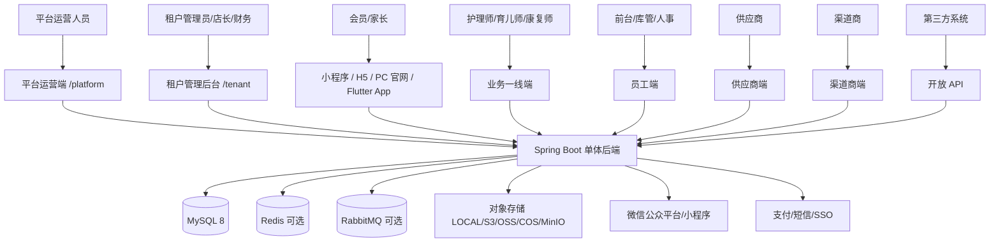
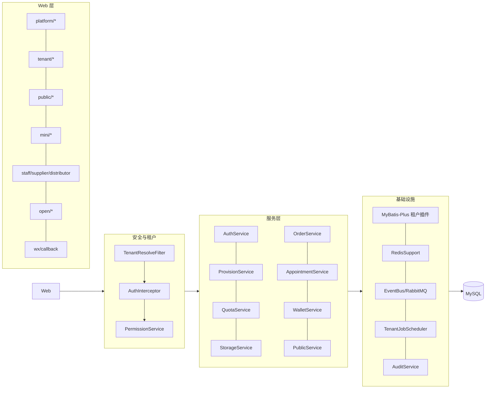
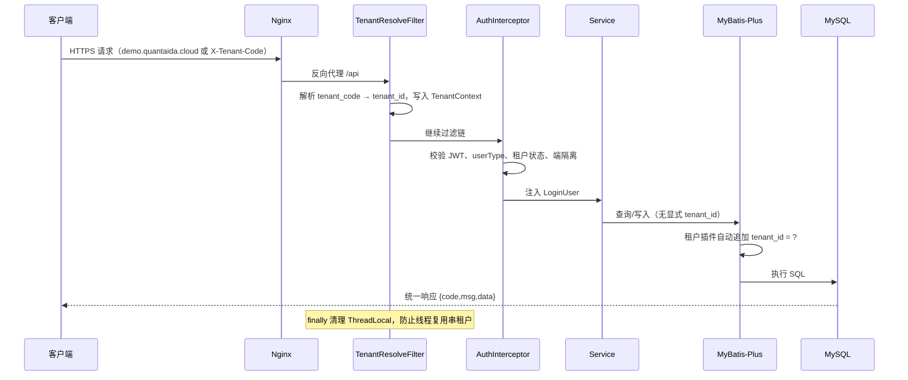
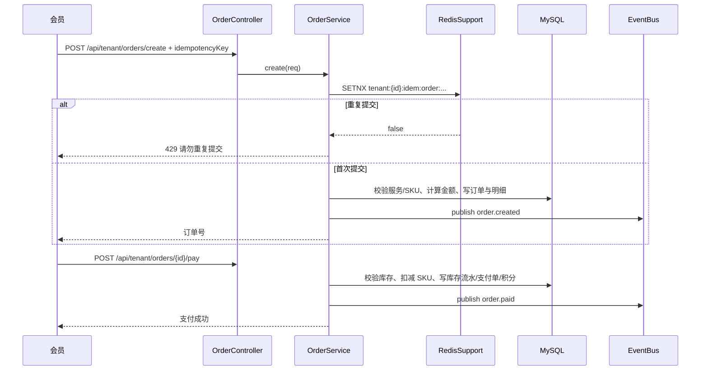

# 架构设计 | 母婴亲子 数字化多端平台

> 版本：v1.0　更新时间：2026-11　对应任务：T23 / T24 / T25

## 1. 设计目标

| 目标 | 设计手段 |
| --- | --- |
| 一套后端服务多端 | REST API + 端类型/角色权限 + 统一响应与错误码 |
| 多租户强隔离 | 共享库 + `tenant_id` 行级隔离 + MyBatis-Plus 租户插件 |
| 平台/租户物理分离 | `/api/platform/*` 与 `/api/tenant/*` 路由、菜单、角色、登录入口分离 |
| 快速开通 | 套餐模板 + 默认角色/菜单/参数复制，目标 ≤ 3 分钟 |
| 外部能力可替换 | 存储 5 驱动、短信 6 渠道、SSO 4 协议、消息 4 通道统一抽象 |
| 可渐进扩展 | 单体优先，按域拆分模块；Redis/RabbitMQ 可选启用 |

## 2. 系统上下文



## 3. 部署拓扑

```mermaid
graph TD
    Internet[公网用户] -->|HTTPS 443 IPv4| N[Nginx 宝塔]
    N -->|/api /files| App[Spring Boot jar :8080]
    N -->|quantaida.cloud| Site[PC 官网静态资源]
    N -->|admin.quantaida.cloud| Admin[管理后台静态资源]
    N -->|app.quantaida.cloud / *.quantaida.cloud| H5[uni-app H5 静态资源]
    App --> DB[(MySQL 8)]
    App --> Redis[(Redis)]
    App --> MQ[(RabbitMQ)]
    App --> Disk[(本地对象存储 tenants/{id}/)]
    App --> WX[微信 API]
```

> Nginx 仅监听 IPv4：`listen 80;` / `listen 443 ssl;`，不写 `listen [::]:443`。通配符证书覆盖 `*.quantaida.cloud`。

## 4. 后端模块划分



## 5. 多租户请求链路



### 隔离四条铁律

1. 所有业务表必须包含 `tenant_id`，并建立以 `tenant_id` 开头的复合索引。
2. 业务代码禁止手写跨租户查询；确需平台汇总时使用显式白名单 Mapper。
3. 缓存 key 必须为 `tenant:{id}:...`，对象存储路径必须为 `tenants/{id}/...`。
4. 通过资源 ID 访问时必须经租户插件过滤；跨租户命中返回 `403` 并写审计。

## 6. 下单与支付时序



## 7. 定时任务按租户分片

```mermaid
flowchart TD
    A[每日 03:00 触发] --> B{app.job.enabled}
    B -- 否 --> Z[跳过]
    B -- 是 --> C[查询 ACTIVE 租户]
    C --> D[遍历租户]
    D --> E[Redis 获取 platform:job:{name}:{tenantId}:{date} 锁]
    E -->|失败| F[跳过，其他实例已执行]
    E -->|成功| G[设置 TenantContext / TenantCode]
    G --> H[执行 TenantJob]
    H --> I{异常?}
    I -- 是 --> J[记录日志，继续下一租户]
    I -- 否 --> K[正常结束]
    J --> L[清理 ThreadLocal]
    K --> L
    L --> D
```

实现入口：`common/TenantJob.java`、`common/TenantJobScheduler.java`、`common/DailyMaintenanceJob.java`。

## 8. 架构决策记录（ADR）

### ADR-001 共享库 + `tenant_id` 行级隔离

- **背景**：目标客户为区域母婴连锁，租户数量中等，要求开通快、成本低。
- **决策**：单库共享表，MyBatis-Plus 租户插件统一注入 `tenant_id`；平台表与全局字典表白名单。
- **理由**：开通无需建库、迁移简单、跨租户统计方便；配合复合索引可满足中小规模性能。
- **代价**：必须严格代码规范与测试；超大规模需按租户分库。
- **缓解**：隔离专项测试、跨租户 403 + 审计、缓存/存储前缀规范、索引审查。

### ADR-002 平台端与租户端物理分离

- **背景**：平台运营方需要汇总视图，租户管理员只能看本租户数据，二者权限模型不同。
- **决策**：路由前缀、JWT `userType`、菜单、角色、登录入口全部分离；平台账号不能登录租户端，租户账号不能访问平台端。
- **理由**：比单套路由加条件判断更不容易越权，审计边界清晰。
- **代价**：前端存在少量重复页面；通过共享组件降低维护成本。

### ADR-003 多端一后端

- **背景**：官网、公众号、小程序、H5、App、一线端、员工端、供应商端、渠道商端、开放 API 共用业务数据。
- **决策**：统一 REST API；端差异通过 `terminal`、角色权限、资源路径与返回字段裁剪实现。
- **理由**：避免数据孤岛，UnionID/会员/订单/积分天然一致。
- **代价**：接口需兼顾多端字段；通过 DTO/资源注册表与端隔离拦截器控制。

### ADR-004 对象存储抽象

- **背景**：客户可能使用本地磁盘、阿里云 OSS、腾讯云 COS、S3 兼容或 MinIO。
- **决策**：统一 `StorageService` 入口，配置表保存驱动与凭证；当前 LOCAL 完整可写，云端驱动预留适配并返回明确错误码。
- **理由**：不绑定单一云厂商；切换驱动时历史文件仍可按 URL 读取。
- **代价**：云端 SDK 需在凭证齐备后接入并做连通性测试；切换需二次确认与迁移说明。

## 9. 技术选型对比

| 维度 | 选择 | 备选 | 结论 |
| --- | --- | --- | --- |
| 后端框架 | Spring Boot 3 | Quarkus / Go | 团队 Java 生态成熟，MyBatis-Plus 租户插件直接可用 |
| ORM | MyBatis-Plus | JPA / MyBatis 原生 | 租户插件、分页、逻辑删除开箱即用，SQL 可控 |
| 租户隔离 | 共享库行级 | 独立库 / 独立 schema | 成本与开通速度优先；预留分库阈值 |
| 缓存 | Redis | Caffeine / 无缓存 | 限流/防重/编号/任务锁需跨实例；本地可降级 |
| 消息 | RabbitMQ | Kafka / RocketMQ | 业务量中等，延迟队列与手动 ACK 满足预约/订单通知 |
| 管理后台 | Vue3 + Element Plus | React + Ant Design | 交付团队熟悉，组件覆盖后台场景 |
| 多端 | uni-app | Taro / 原生小程序 | 一套代码覆盖小程序/H5/App 壳，成本低 |
| App | Flutter | React Native / 原生 | 双端一致性与性能平衡，单仓双端 |
| 部署 | 宝塔 + Nginx | K8s / 云托管 | 客户现有运维习惯，交付与排障成本低 |

## 10. 风险与缓解

| 风险 | 影响 | 概率 | 缓解措施 |
| --- | --- | --- | --- |
| 跨租户越权 | 数据泄露 | 中 | 租户插件 + 403 + 审计 + 自动化隔离测试 + 代码评审 |
| 微信资质/模板未就绪 | 公众号/支付不可用 | 高 | 台账/Mock + 发布闸门 + 配置化接入清单 |
| Redis/RabbitMQ 未部署 | 限流/异步降级 | 中 | 自动降级单机/日志，监控告警，生产启用开关 |
| 单库数据量增长 | 查询变慢 | 中 | 复合索引、归档、读写分离；超过阈值按租户分库 |
| 对象存储切换 | 历史文件不可读 | 低 | 保留旧驱动只读、URL 兼容、迁移脚本与灰度 |
| 定时任务重复执行 | 数据重复处理 | 低 | Redis 分布式锁 + 幂等键 + 单租户异常隔离 |
| 敏感字段泄露 | 合规风险 | 中 | AES 加密、脱敏展示、日志脱敏、最小权限 |

## 11. 扩展规划与隔离升级阈值

| 指标 | 当前方案 | 触发阈值 | 升级动作 |
| --- | --- | --- | --- |
| 租户数 | 单库共享 | > 2,000 或单表 > 5,000 万行 | 按租户分库/分表，路由层改造 |
| 日订单 | 单库 | > 50 万 | 订单归档、读写分离、消息削峰 |
| 存储 | 本地磁盘 | > 500 GB 或跨机房 | 切换 OSS/COS/S3，CDN 加速 |
| 定时任务 | 单实例分片 | > 10 万租户 | 调度中心 + 分片队列 |
| 部署 | 单机 jar | 持续高可用要求 | 多实例 + 负载均衡 + 健康检查 |

## 12. 可观测性与运维

- 日志：`./logs/app.log`，按 50 MB 滚动、保留 30 天；审计日志独立入库。
- 健康检查：`/api/public/config` 可用于反向代理探活（无敏感信息）。
- 指标建议：JVM、Hikari 连接池、Redis 命中、RabbitMQ 队列积压、接口 P95、租户配额使用率。
- 告警建议：5xx 比例、登录失败激增、队列死信、备份失败、证书到期。
- 发布：蓝绿/滚动由 Nginx upstream 控制；数据库变更使用增量 SQL，禁止 `DROP/TRUNCATE`。
